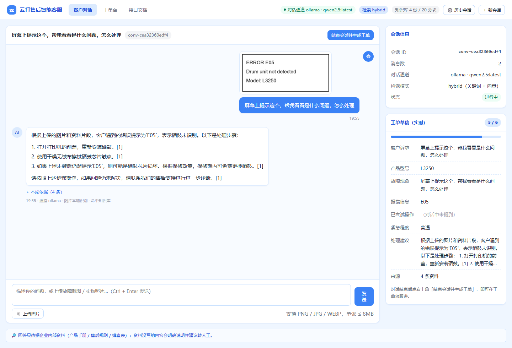
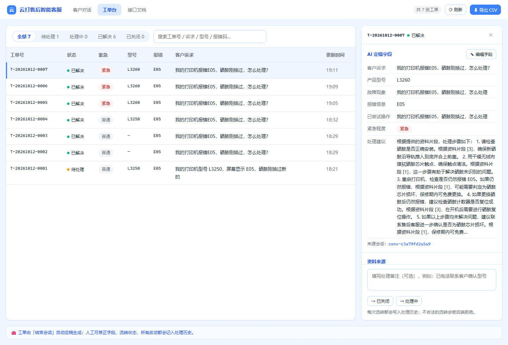
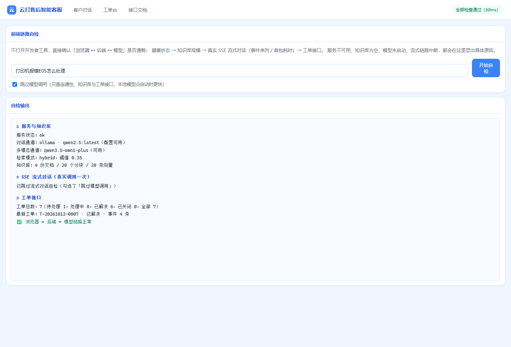

# DSH-E · 多模态企业智能客服系统

远程仓库：<https://github.com/Adar-AI/DSH-E>

面向中小企业售后场景、**单机本地运行**的 Web 应用：客户用文字 + 故障截图/实物照片提问，系统**只依据企业内部资料**（PDF/MD 知识库）给出售后方案，并在会话结束时自动生成结构化工单归档，供人工客服跟进。

- 多模态输入：文字 + 图片（报错截图 / 实物照片）
- 私域知识优先：本地 BGE-M3 向量 + SQLite FTS5 混合检索，检索不到就明确说"资料未收录"，不编造
- 多轮记忆：LangGraph + SQLite checkpointer，刷新页面不丢上下文
- 工单闭环：对话中增量抽取，会话结束定稿落库，工单台可流转状态并导出

## 文档

| 文档 | 内容 |
|---|---|
| [需求规格说明书](docs/需求规格说明书.md) | 角色场景、11 项功能需求与验收标准、非功能需求、界面规范、里程碑 |
| [架构说明](docs/架构说明.md) | 总体架构、模块职责、数据模型、检索设计、LangGraph 图、接口契约、测试策略 |

## 技术栈

FastAPI + uvicorn · LangGraph（含 SQLite checkpointer） · SQLite（FTS5 + sqlite-vec） · 本地 BGE-M3（1024 维） · Ollama `qwen3:4b`（默认对话，DeepSeek API 备用） · OpenAI 兼容多模态网关（图片理解） · 原生 HTML/CSS/JS 前端（淡蓝色）

## 快速开始

项目固定使用这个虚拟环境（已按本机 Python 3.12.7 重建）：

```powershell
$py = 'C:\Users\19181\PyCharmMiscProject\.venv\Scripts\python.exe'

# 1. 安装依赖（该 venv 继承了本机已装的 torch/langgraph 等重依赖，只需补差量）
& $py -m pip install -r requirements.txt

# 2. 准备配置：复制模板后填入密钥（.env 已被 .gitignore 忽略）
Copy-Item .env.example .env

# 3. 准备本地对话模型（本机已有 qwen2.5:latest，可直接用）
ollama list

# 4. 把演示资料入库（3 份中文资料 + 1 份 PDF，共 20 个分块）
& $py scripts\ingest_samples.py
```

### 启动与验证

```powershell
# 想先跑通后端逻辑、不依赖任何模型：离线模式
.\scripts\run.ps1 -Mode mock

# 用真实模型（Ollama + 多模态网关）：读 .env 配置
.\scripts\run.ps1

# 后端全链路冒烟（健康检查/静态资源/对话 SSE/图片上传/兜底/工单/字段编辑/流转/导出），18 项检查
.\scripts\smoke_backend.ps1

# 两套测试一起跑（Node 文档校验 + pytest）
.\scripts\test.ps1
```

浏览器打开 <http://127.0.0.1:8000>。脚本会自动定位解释器：`-Python` 参数 >
`$env:PROJECT_PYTHON` > `C:\Users\19181\PyCharmMiscProject\.venv` > 本机安装 > PATH。

## 用本地 Ollama 测试

本项目默认就走本地 Ollama（离线、零 API 费用），完整步骤如下：

```powershell
# 1. 确认 Ollama 在跑、模型已在本地
ollama list                       # 期望看到 qwen2.5:latest（或你想要的指令模型）
ollama serve                      # 若尚未常驻

# 2. 用真实模型启动服务（默认 auto 模式，会自动预热模型）
.\scripts\run.ps1

# 3. 自检：确认通道、检索、流式对话、工单接口都通
.\scripts\smoke_backend.ps1
#    或打开 http://127.0.0.1:8000/static/selftest.html 点「开始自检」
```

要点与排错：

| 现象 | 原因 / 处理 |
|---|---|
| 第一次提问特别慢（60s+） | 本地模型冷启动要把权重读进显存。服务启动时会**后台预热**，等 10~20 秒再提问即可 |
| `model 'qwen3:4b' not found` | 该模型没下载。`ollama pull qwen3:4b`，或把 `.env` 的 `OLLAMA_MODEL` 改成已有模型 |
| 回答像"背课文"或答非所问 | 6GB 显存下 7B 模型会部分落到 CPU；可换更小的指令模型，或参考 `docs/架构说明.md` 7.1 的实测数据 |
| 思考型模型回答为空 | `qwen3` / `deepseek-r1` 把预算花在推理上。代码已自动追加 `/no_think`（`DISABLE_THINKING=false` 可关） |
| 想换模型/换端口 | 改 `.env` 的 `OLLAMA_MODEL` / `PORT`，重启 `run.ps1` |
| 不想依赖模型先调前端 | `.\scripts\run.ps1 -Mode mock`，对话与视觉换成确定性假模型 |

### 图片理解也走本地（可选）

```powershell
ollama pull qwen2.5vl:3b     # 3.2GB，非思考模型、中文 OCR 强
```

`.env` 默认已指向它（`VISION_BASE_URL=http://127.0.0.1:11434/v1`、`VISION_MODEL=qwen2.5vl:3b`），
启动后 `/api/health` 会显示：

```
vision: model=qwen2.5vl:3b  kind=本地 Ollama  local=true
        channels: vision-local（主通道）→ vision-cloud-fallback（回退通道）
```

实测数据（本机 RTX 3060 Laptop 6GB）：

| 项 | 结果 |
|---|---|
| 纯视觉推理 | 8.5s（560×260 截图） |
| 一次完整图片问答 | 34.6s —— 6GB 显存装不下两个模型，中间有**两次换页**（文本→视觉→文本） |
| 文字问答 | 热态 4.9s，冷启动 27.6s |
| 识别质量 | 正确读出型号 L3250、错误码 E05、报错位置与英文提示，置信度 0.9 |
| 本地不可用时 | 4.7s 内自动回退云端网关，结果里标明实际通道 |

想更快可以：① 把视觉换成 `qwen3-vl:2b`（1.9GB，换页更快）；② 文本与视觉统一用 `gemma3:4b`（单模型双模态，零换页）；
③ 或保留市面上识别最好但需联网的云端视觉（把 `VISION_MODEL` 指向云端模型即可）。

## 检索增强：三档置信 + 重排 + 联网兜底（v2.1）

一句话：**问得不清楚就反问、资料没有就说没有、内部不够才联网**，用多层判断把幻觉挡在外面。

```
用户提问
  ↓ ① 意图确认与改写   实体对齐（图片/草稿/历史）+ 查询改写
  ├─ 缺主语且上下文有多个型号 → 反问澄清（列出候选，不猜不答）
  ├─ 缺主语且无上下文型号     → 拒答（说明要补型号，可转人工）
  └─ 明确 → 继续
  ↓ ② 内部多路召回（多查询变体）
  ↓ ③④⑤ RRF 融合 → 本地重排 → 动态 TopK
  │     内部证据不足（重排分低 或 主题没覆盖）才触发 ⑥ MCP 联网兜底
  ↓ ⑥ 生成：内部依据标 [1]，联网来源标 [网1] 并注明"仅供参考"
```

配置（`.env`，全部有默认值）：

```ini
RERANK_MODEL_PATH=D:/ai_models/modelscope_cache/models/rerank/BAAI/bge-reranker-large
RERANK_MIN_SCORE=0.10     RERANK_RELATIVE_FLOOR=0.35
RERANK_CLIFF_RATIO=0.5    RERANK_TOP_K_MAX=6
CONFIDENCE_HIGH=0.50      CONFIDENCE_LOW=0.10      CLARIFY_MAX_ROUNDS=2
LLM_ALIGN_ENABLED=false   # 边界区间是否再问一次模型（默认关，省一次调用）
MCP_ENABLED=true          MCP_BASE_URL=<百炼 EnhancedSearch 端点>   MCP_API_KEY=<仅存 .env>
MCP_TRIGGER_TOP1=0.35     MCP_TRIGGER_COVERAGE=0.34
```

实测（本机，真实模型）：明确问题精排 top1 **0.9967**、保留 6 条；
「保修期是多少？」在有多个型号上下文时触发**反问**（候选 L3250/M1136）、全新会话触发**拒答**；
场外问题走兜底；冒烟 **21/21**。阈值标定与两个真实缺陷（重排分判不出"问得清不清楚"、
型号词把分数抬高到 0.84 导致联网不触发）的排查过程见 `docs/架构说明.md` 第 13 节。

## 页面与深链

| 页面 | 地址 | 说明 |
|---|---|---|
| 客户对话 | <http://127.0.0.1:8000/> | 文字 + 图片提问，流式回答，右栏工单草稿实时预览 |
| 人工客服工单台 | <http://127.0.0.1:8000/admin> | 列表筛选、详情、人工修正字段、状态流转、导出 CSV |
| 前端自检 | <http://127.0.0.1:8000/static/selftest.html> | 不用开发者工具就能定位链路问题 |
| 接口文档 | <http://127.0.0.1:8000/docs> | Swagger |

深链：`/?conv=<会话ID>` 直接打开某个会话；`/admin?ticket=<工单ID>` 直接打开某张工单。

## 界面预览

| 客户对话页 | 人工客服工单台 |
|---|---|
|  |  |

前端自检页：

## 目录结构

```
app/            后端：API、LangGraph 图、检索、入库、工单
app/web/        前端：index.html 对话页、admin.html 工单台、selftest.html 自检页、css/、js/
data/           本地数据：app.db、uploads/、docs/（samples 演示资料入库，user 私有资料不入库）
docs/           需求规格、架构说明、界面截图
scripts/        入库 / 启动 / 测试 / 冒烟 / 通道自检 / 资料生成脚本
tests/          Python 单测（pytest）
test/           Node 文档与仓库完整性校验
```

## 知识库（只读）

知识库是系统回答的**唯一依据**，网页端不提供修改入口，避免误改依据数据。维护方式：

```powershell
& $py scripts\ingest_samples.py            # 入库 data/docs/samples（演示资料）
& $py scripts\ingest_samples.py --user     # 入库 data/docs/user（放你的真实 PDF/MD）
& $py scripts\ingest_samples.py --force    # 文件改过之后重新入库（默认按 sha256 跳过未变化的）
& $py scripts\ingest_samples.py --rebuild  # 换了嵌入模型后整体重建索引
```

支持 PDF / MD / TXT。入库后可在对话页提问，或用 `/api/health` 查看文档与分块数。

## 开发进度

| 里程碑 | 内容 | 状态 |
|---|---|---|
| M0 | 需求与架构文档、仓库骨架、依赖清单、仓库校验测试 | ✅ 完成 |
| M1 | 数据层：schema、FTS5、sqlite-vec 装载与迁移 | ✅ 完成 |
| M2 | 入库管线 + 混合检索（BGE-M3 + RRF + 阈值） | ✅ 完成 |
| M3 | LLM 封装 + 多模态视觉 + 探测脚本 | ✅ 完成 |
| M4 | LangGraph 对话图 + 多轮记忆 + SSE 接口 | ✅ 完成 |
| M5 | 工单抽取、落库、状态流转、导出 | ✅ 完成 |
| M6 | 前端两页 + 端到端联调 | ✅ 完成 |
| M7 | 演示资料（含 PDF）+ 启动说明 + 收尾验证 | ✅ 完成 |

## 开发与测试

```powershell
.\scripts\test.ps1          # 两套测试一起跑（推荐）
npm test                     # 仅 Node：文档与仓库完整性校验（零依赖）
& 'C:\Users\19181\PyCharmMiscProject\.venv\Scripts\python.exe' -m pytest tests -q
```

当前规模：pytest 261 项 + Node 11 项，全部离线可跑（模型调用均有假实现）。

## 约定

本仓库遵循 [AGENTS.md](AGENTS.md)：

- 每次改动完成，都要创建一个对应的 Git commit，便于后续追踪和回滚；
- 每次改动完成，都要编写或更新相关测试，并在交付前确保所有测试和验证全部通过。

## 转人工与界面权限（V3）

| 页面 | 谁用 | 说明 |
|---|---|---|
| `/` 客户对话 | 客户 | 只有对话；需要人工时点「🙋 转人工客服」 |
| `/admin` 工单台 | **人工客服** | 直接访问；客户界面不暴露该入口 |
| `/docs` | 开发 | FastAPI 文档，不在界面暴露 |

客户要求转人工（说「转人工」或点按钮）后：立即生成工单（紧急度≥较急）→ 工单台顶部出现
「🔔 转人工提醒」（计数 + 脉冲高亮，每 5 秒刷新）→ 客服点开右侧会话面板即可与客户对话，
首次发言自动接管；客户页面每 3 秒轮询，客服回复会实时出现在对话里。
**人工期间机器人不再自动回答**，避免抢答。

### 客服结束会话（V4）

客服在会话面板点「✅ 结束会话」即可收工：该会话**立即从「转人工提醒」栏移除**，
工单同步置「已解决」并把人工阶段的对话重新整理进工单字段，客户同时收到一条
「本次人工服务已结束」的系统提示。客户若继续提问，机器人会重新接管。
（提示：抽取字段会调用一次模型，实测约 2.7 秒。）
